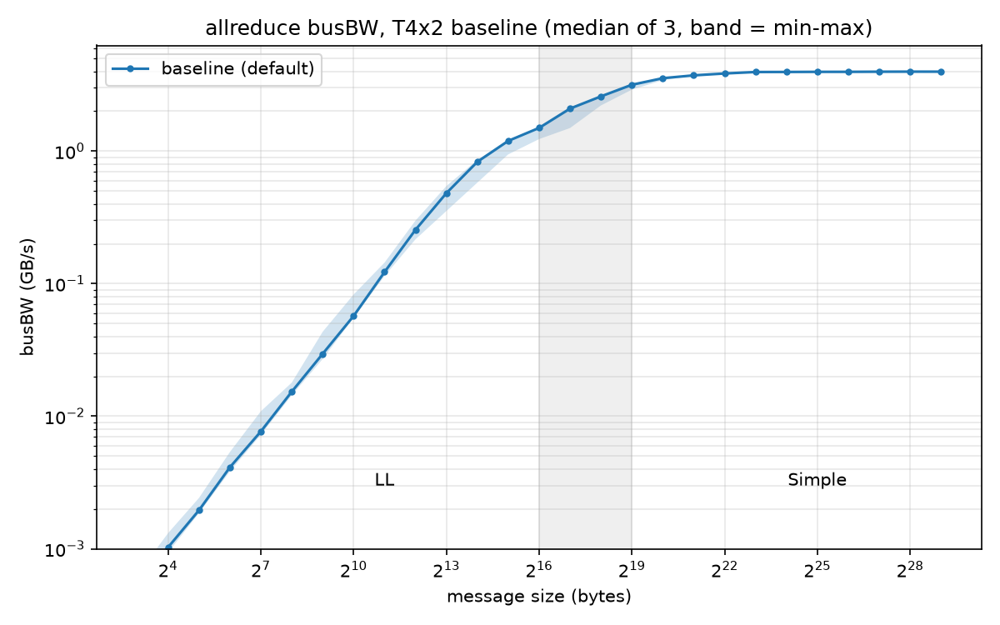
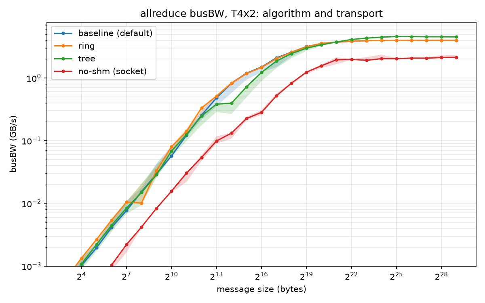
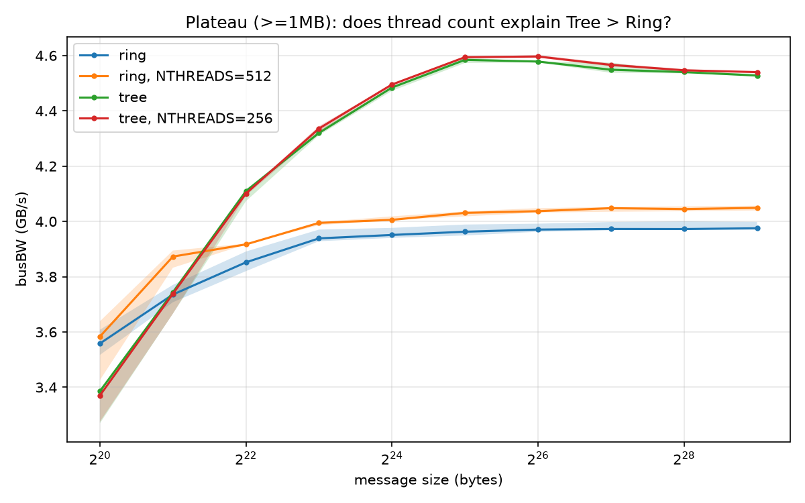

<div align="center">

# nccl-allreduce-bench

**Controlled NCCL allreduce experiments that explain *why* the busBW curve looks the way it does.**

[](https://github.com/NVIDIA/nccl)
[](https://github.com/NVIDIA/nccl-tests)
[](#environment)
[](requirements.txt)

[Overview](#overview) • [Key findings](#key-findings) • [Getting started](#getting-started) • [Results](#results) • [Background](#background) • [中文摘要](#中文摘要)



</div>

## Overview

This repo benchmarks NCCL allreduce on two Tesla T4 GPUs (Kaggle "GPU T4 x2").
Instead of reporting a single bandwidth number, it breaks the busBW curve down into the layers that shape it: **topology → transport → algorithm → protocol**.

Every experiment follows three rules:

- **One variable at a time.** Each condition changes a single NCCL setting relative to the baseline.
- **Prove the change took effect.** A short `NCCL_DEBUG=INFO` run comes first and shows the transport, algorithm, protocol or thread count actually in use.
- **Clean timing.** Timing runs never use debug output, sweep 8 B → 512 MB, and repeat 3 times. Tables report the median; plots show the min–max band.

## Key findings

| | Finding | Evidence |
|---|---|---|
| 1 | P2P is unavailable between the two T4s (PHB inside a VM). NCCL falls back to **SHM** through host memory. | `intraNodeP2pSupport 0`, `via SHM/direct/direct` |
| 2 | The bandwidth plateau is **3.97 GB/s**, about 30% of what PCIe Gen3 x16 achieves (~12–13 GB/s). | 3 runs, < 0.5% spread at ≥ 4 MB |
| 3 | The curve consists of two protocols. **LL**: α ≈ 12 µs, β ≈ 2.1 GB/s. **Simple**: α ≈ 29 µs, β ≈ 4.0 GB/s. LL's β is about half of Simple's because of its 4-byte flags. | per-protocol α-β fit |
| 4 | With NCCL forced to **Tree**, large messages run **14.5% faster** than Ring. NCCL still picks Ring by default, because its model predicts 10 GB/s for Ring (measured: 3.97). | TUNING table, `Algo RING` |
| 5 | The thread-count hypothesis (Tree 512 vs Ring 256) is **rejected**. Ring at 512 threads gains only +1.8%; Tree at 256 threads is unchanged. | single-variable runs + diag logs |
| 6 | Disabling SHM (falling back to Socket) makes α **~4×** worse and cuts bandwidth by **47%**. | `via NET/Socket/0` |

> [!NOTE]
> These results describe a **virtualized** PCIe platform without P2P. On bare metal with P2P or NVLink, the numbers and even the default algorithm choice will differ. The method carries over.

## Getting started

### Regenerate tables and figures from the committed logs

This works on any machine; no GPU is needed.

```bash
git clone https://github.com/sxwangsxwang1/nccl-allreduce-bench.git
cd nccl-allreduce-bench
pip install -r requirements.txt
python scripts/analyze.py
```

The script writes [`results/summary.md`](results/summary.md) and the PNGs in [`figures/`](figures/).

### Re-run the experiments

You need a Linux machine with 2 GPUs and CUDA. On Kaggle, set Accelerator = **GPU T4 x2** and Internet = **On**.

```bash
git clone --depth 1 https://github.com/NVIDIA/nccl-tests.git
make -C nccl-tests -j"$(nproc)"
bash scripts/run_experiments.sh
```

> [!TIP]
> On Kaggle, `apt-get install libnccl-dev` can fail with *held packages*. Build against the NCCL that ships with PyTorch instead:
> 1. Point `NCCL_HOME` to the output of `python -c "import nvidia.nccl, os; print(os.path.dirname(nvidia.nccl.__file__))"`.
> 2. Create a `libnccl.so` → `libnccl.so.2` symlink in its `lib/` directory.
> 3. Set `LD_LIBRARY_PATH` with `os.environ`. A `!export` in one notebook cell does not carry over to the next.

> [!IMPORTANT]
> Check that the `NCCL version` line in the diagnostic log matches the library you compiled against. A mismatch loads silently and is easy to miss.

## Environment

| | |
|---|---|
| GPUs | 2× Tesla T4 (16 GB, PCIe Gen3 x16), Kaggle VM, 4 vCPUs |
| Topology | `nvidia-smi topo -m`: GPU0↔GPU1 = **PHB** |
| NCCL / nccl-tests | 2.25.1 / 2.21.1, single process, `-g 2` |
| Collective | allreduce, float32, sum. With n = 2, **busBW = algBW**. |

## Experiments

| Condition | Variable changed | Verified in diag log |
|---|---|---|
| `baseline` | none (NCCL defaults) | transport, algorithm and protocol per size |
| `ring` | `NCCL_ALGO=Ring` | identical to baseline, used as the noise floor |
| `tree` | `NCCL_ALGO=Tree` | `Algo TREE proto SIMPLE` |
| `noshm` | `NCCL_SHM_DISABLE=1` | `via NET/Socket/0` |
| `ring512` | `NCCL_ALGO=Ring NCCL_NTHREADS=512` | Ring Simple `Max NThreads` 256 → 512 |
| `tree256` | `NCCL_ALGO=Tree NCCL_NTHREADS=256` | Tree Simple `Max NThreads` 512 → 256 |

## Results

All values are medians of 3 timing runs. busBW is recomputed from the `time` column, because the log's `busbw` column rounds small messages to 0.00.

### Transport: SHM because P2P is unavailable

```
Check P2P Type intraNodeP2pSupport 0 directMode 1
Channel 00 : 0[0] -> 1[1] via SHM/direct/direct
```

The GPUs sit on a flat virtual PCI bus (`00:04`, `00:05`). Data travels GPU0 → PCIe → host memory → PCIe → GPU1.

### Protocols: one α-β model is not enough

NCCL ran **LL** up to 64 KB and **Simple** from 512 KB upward (Ring in both cases). LL128 is disabled on PCIe.

| Protocol | Fit range | α (µs) | β (GB/s) | Knee α·β |
|---|---|---|---|---|
| LL | 8–64 KB | 12.4 | 2.11 | 26 KB |
| Simple | ≥ 512 KB | 29.4 | 3.97 | 117 KB |

A single fit, with α taken from small messages and β from large ones, put the knee at ~62 KB. The measured curve reaches β/2 at ~128 KB.
**The two endpoints of that fit came from different protocols.** Fitting each protocol separately fixes this:

- Simple's knee (117 KB) matches the measured β/2 point.
- The two fits break even at ~76 KB, inside the 64–512 KB window where the diagnostic log shows the protocol switch.

### Algorithm: Tree beats Ring at large sizes



| Size | Ring | Tree | Socket (no SHM) |
|---|---|---|---|
| 16 KB | 0.83 | 0.40 | 0.13 |
| 1 MB | 3.56 | 3.39 | 1.57 |
| 64 MB | 3.97 | **4.58** | 2.08 |
| 512 MB | 3.98 | **4.53** | 2.13 |

- **Prediction:** with 2 ranks, Ring and Tree are the same 0⇄1 chain, so they should perform about the same. **The data rejects this prediction.** Tree's 14.5% gain is far above the < 0.5% noise floor.
- Tree is slower at 8 KB–1 MB. The jump at 8 → 16 KB (21 → 41 µs) looks like an earlier LL → Simple switch. This has not been verified yet.
- NCCL's model predicts Ring/Simple at 10.0 GB/s and Tree/Simple at 4.6 GB/s. Tree's estimate is accurate; Ring's is 2.5× too high, so the default picks the slower algorithm.

### Hypothesis: does thread count explain Tree > Ring?



| Condition | Simple threads | Plateau (GB/s) | vs Ring |
|---|---|---|---|
| ring | 256 | 3.97 | — |
| ring, `NCCL_NTHREADS=512` | 512 ✓ | 4.04 | +1.8% |
| tree | 512 | 4.55 | +14.5% |
| tree, `NCCL_NTHREADS=256` | 256 ✓ | 4.56 | +14.8% |

**Rejected as the main cause.** Testing both directions, thread count explains at most ~2 of the 14.5 percentage points.

### Transport: SHM vs Socket

| | SHM | Socket |
|---|---|---|
| Small-message time (8 B–1 KB) | 14–16 µs | 60 µs |
| Plateau | 3.97 GB/s | 2.10 GB/s |

The Socket path adds a CPU proxy thread, the TCP stack and system calls. The cost is mostly fixed (α ~4×); bandwidth only halves.

## Open questions

- [ ] **Why is the plateau only ~4 GB/s?** Measure single-link H2D/D2H with a pinned `torch` copy and check the link state under load (`nvidia-smi -q -d PCI`).
- [ ] **Why is Tree 14% faster?** Next single-variable candidates: `NCCL_BUFFSIZE`, `NCCL_MIN_NCHANNELS=4`. Then read the SHM transport and the Ring/Tree kernels in the NCCL source.
- [ ] **Where does Tree switch protocol?** Run a narrow `NCCL_ALGO=Tree` TUNING diagnostic over 4 KB–1 MB.

> [!WARNING]
> **Limitations**
> - **One VM, one session.**
> - **Single process, `-g 2`.** `torchrun` uses one process per GPU, where P2P/SHM setup goes through IPC and may behave differently.
> - **Only 3 runs per condition.** The first run of a session was up to ~30% slower at 64–128 KB, which is why the tables use medians.
> - **No single-GPU baseline, by design.** With n = 1, allreduce does no communication.

## Background

<details>
<summary><b>Topology labels</b> (<code>nvidia-smi topo -m</code>)</summary>

| Label | Path between two GPUs |
|---|---|
| `NV#` | NVLink (# links) |
| `PIX` | at most one PCIe switch |
| `PXB` | several PCIe switches, without going through the CPU |
| `PHB` | through the CPU's PCIe host bridge |
| `NODE` | across host bridges inside one CPU |
| `SYS` | across CPU sockets (UPI / Infinity Fabric) |

P2P is reliable at PIX/PXB. At PHB it depends on the platform, and inside a VM it is usually blocked by the IOMMU and ACS.

</details>

<details>
<summary><b>Transports</b>: P2P, SHM, NET</summary>

| Transport | Path | Notes |
|---|---|---|
| P2P | GPU → GPU (PCIe or NVLink) | fastest; needs peer access |
| SHM | GPU → host memory → GPU | always available; crosses PCIe twice |
| NET | GPU → host → NIC or socket → host → GPU | last resort inside a node |

</details>

<details>
<summary><b>Algorithms</b>: Ring vs Tree</summary>

- **Ring:** reduce-scatter followed by all-gather. That is 2(n−1) steps of S/n each, so every rank sends 2(n−1)/n·S. Ring is bandwidth-optimal, but its latency grows linearly with n.
- **Tree:** reduce up to the root, then broadcast down, pipelined in chunks. Latency grows with log n. NCCL uses a double binary tree to keep the load balanced.
- **With n = 2,** both algorithms are the same chain. Any difference comes from the implementation.

</details>

<details>
<summary><b>Protocols</b>: LL, LL128, Simple</summary>

| Protocol | How "data ready" is signalled | Efficiency | Latency |
|---|---|---|---|
| LL | each 8-byte store = 4 B data + 4 B flag, written atomically | ~50% | lowest (no fence) |
| LL128 | 120 B data + 8 B flag per 128 B; needs 128 B atomicity (NVLink) | ~94% | low |
| Simple | bulk data, then a memory fence, then a flag | ~100% | highest |

</details>

<details>
<summary><b>algBW, busBW and the α-β model</b></summary>

- `algBW = S / t` is the user's view.
- `busBW = algBW × 2(n−1)/n` (allreduce) is the per-link view. It can be compared with link bandwidth regardless of n.
- `t ≈ α + S/β`. The knee is at `S = α·β`, where busBW reaches β/2.

</details>

<details>
<summary><b>Reading the logs</b></summary>

```bash
grep -h "intraNodeP2pSupport" logs/diag/*.log | sort -u          # is P2P possible?
grep -h " via " logs/diag/*.log | sort -u                        # transport in use
grep -h "Bytes ->" logs/diag/*.log | sort | uniq -c              # algorithm + protocol per call
grep -h "Max NThreads\|set by environment" logs/diag/*.log | sort -u
```

Timing-line columns: `size count type redop root time algbw busbw #wrong`, first for out-of-place and then for in-place. `time` is in µs; GB/s means 10⁹ B/s.

</details>

## Project structure

```
logs/timing/    <cond>_<1..3>.log    timing runs (no debug output)
logs/diag/      <cond>_diag.log      NCCL_DEBUG=INFO runs proving each setting took effect
scripts/
  run_experiments.sh                 every command, in order
  analyze.py                         logs → results/summary.md + figures/*.png
results/summary.md                   generated tables
figures/                             generated plots
notebooks/nccl-t4x2-kaggle.ipynb     original Kaggle notebook, with outputs
```

## 中文摘要

<details>
<summary>展开</summary>

在 Kaggle 的 2× T4 虚拟机上，用 nccl-tests 对 allreduce 做了一组受控实验。方法有三条：一次只改一个变量；每个改动先用诊断日志确认生效；计时跑不开 DEBUG，每组跑 3 次取中位数。

- **拓扑和 transport**：两张卡之间是 PHB，又在虚拟机里，P2P 不可用，NCCL 退到经主机内存中转的 SHM。大消息带宽的平台约 3.97 GB/s，约为 PCIe 的 30%。
- **协议**：按协议分段拟合 α-β。LL 的 α≈12 µs、β≈2.1 GB/s，Simple 的 α≈29 µs、β≈4.0 GB/s。LL 的带宽约为 Simple 的一半；单一 α-β 模型会把拐点低估一半左右。
- **算法**：预期两个 rank 时 Ring 和 Tree 应该差不多，但实测大消息时 Tree 快 14.5%。NCCL 的模型高估了 Ring，所以默认选了更慢的 Ring。
- **假设检验**：从正反两个方向验证了线程数（512 vs 256）这个假设，结果基本被否定。
- **关掉 SHM**：退到 Socket 后，α 约为原来的 4 倍，带宽下降 47%。

</details>
